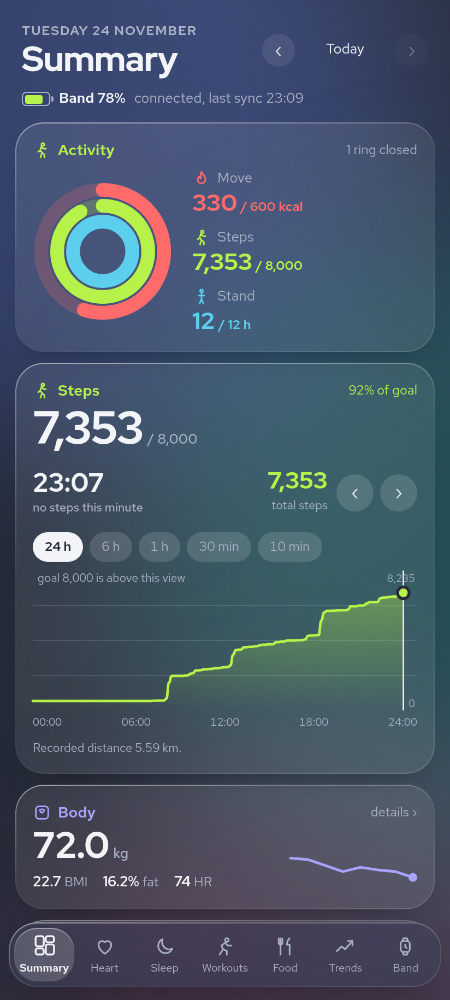
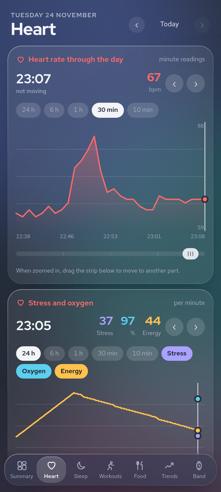
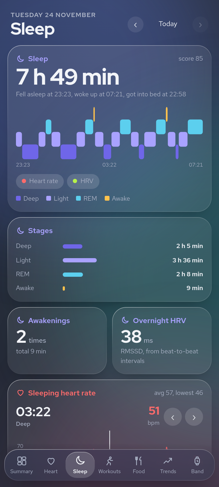
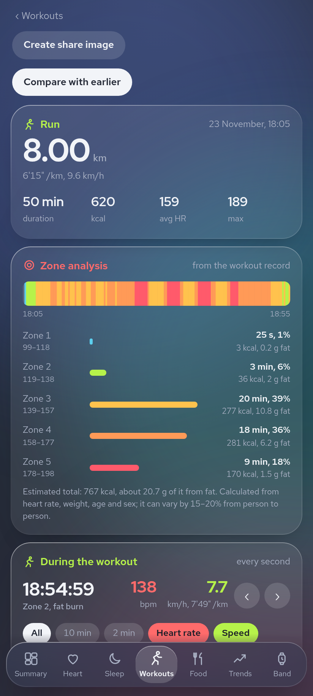
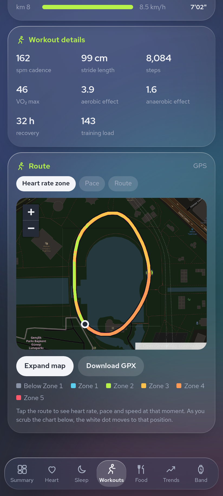
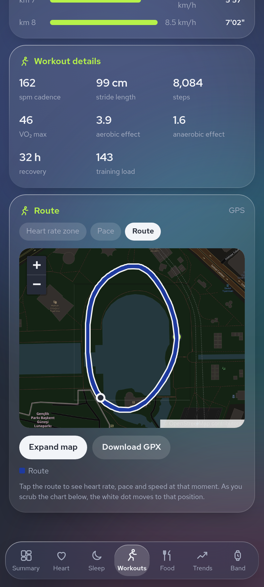
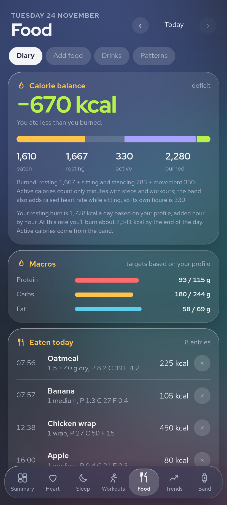
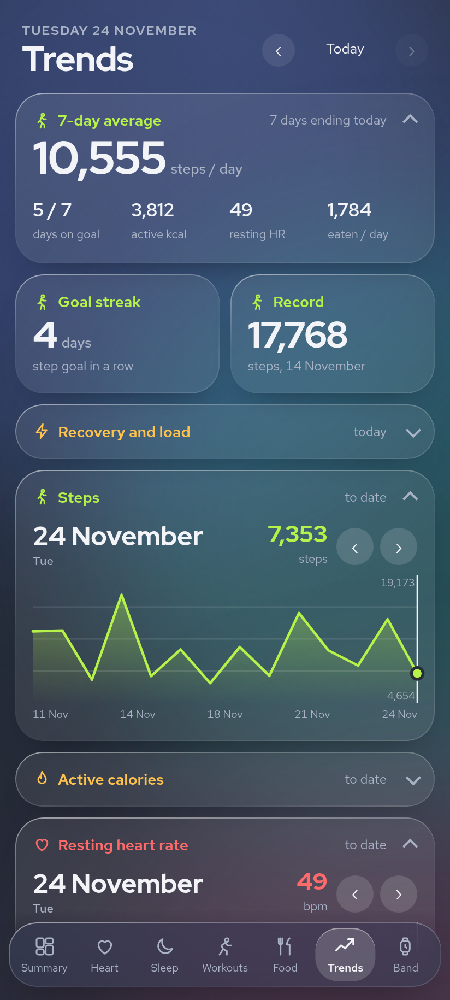
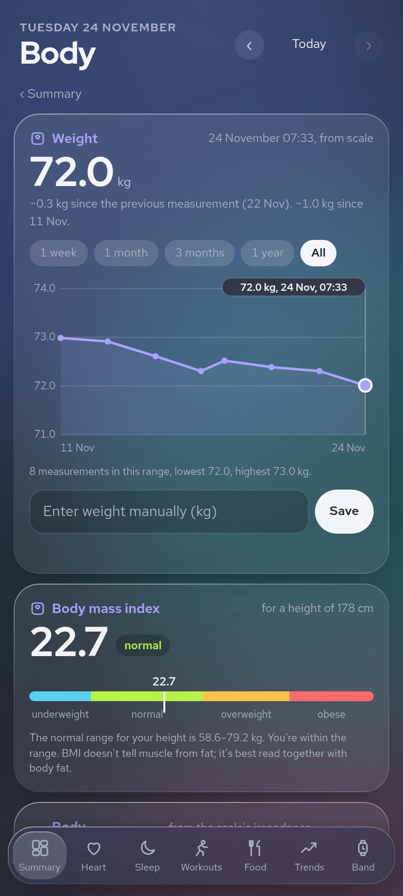
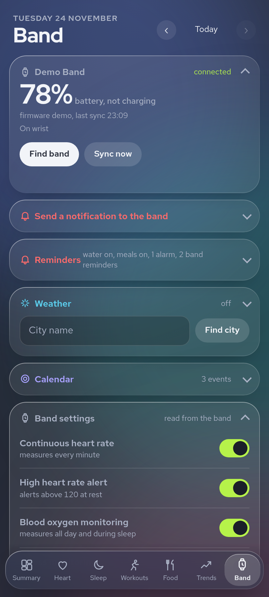

# Smart Band

A self-hosted companion app for smart bands. It talks to the band directly over Bluetooth and keeps
your data on your own device — no account, no cloud and no vendor servers during daily use.

It is meant as a base you adapt to **your own band**: the transport, the protobuf commands and the
file decoders are separate, readable modules, and everything above them (database, insights, web UI,
Android shell) does not care which band the data came from.

> Not affiliated with any band manufacturer. Use at your own risk.

> The app speaks **English and Turkish**; code comments are in Turkish.

<p>
  
  
  
  
  
</p>
<p>
  
  
  
  
  
</p>

All screenshots show made-up sample data produced by [`band/demo.py`](band/demo.py).

## What it is

- **`band/`** — the core, written in Python: Bluetooth transport and session (`client.py`), commands
  (`bandmsg.py`), activity-file decoders (`parse.py`, `parse_more.py`), an SQLite store, insights, and a
  single-page web UI (`web/index.html`). Runs on its own on a Linux PC.
- **`android/`** — an Android shell (Kotlin + Chaquopy + WebView) that runs the very same Python code
  on the phone. See [android/README.md](android/README.md).

## Features

- Downloads steps, calories, heart rate, SpO₂, stress, sleep and workout records from the band
- Daily summary, weekly and monthly trends, recovery and training-load estimates
- Workouts started from the app: distance and route from the phone's GPS, per-second recording, and
  live time / distance / pace / steps mirrored to the band's screen
- Workout map: colour the route by heart-rate zone, by pace, or as a single plain line; tap a point for
  the values at that moment; full-screen view; GPX / CSV export; shareable summary image
- Notifications, music control, weather, alarms, water and meal reminders on the band
- Optional: weight, heart rate and impedance from a Bluetooth body-composition scale (`scale.py`)
- Optional: import of history from a vendor-app data export (`import_mifitness.py`)
- English and Turkish interface, switchable in the app

## Compatibility and adapting it to your band

The protocol layer implements the protobuf-over-SPP protocol used by recent Xiaomi-family wearables,
adapted from [Gadgetbridge](https://codeberg.org/Freeyourgadget/Gadgetbridge). It was developed and
tested against a single band, so expect to adjust things for yours:

- **Same protocol family, different model** — start with `config.json` (address, key, RFCOMM channel),
  then check the activity-file versions your band produces against `parse.py` / `parse_more.py`; file
  layouts differ between models and firmware versions. `probe.py` and `cmdtest.py` are small tools for
  poking at a band, and `testfiles.py` shows how the synthetic test files are built.
- **A different protocol** — replace `client.py` (connect, authenticate, send/receive commands, fetch
  files) and the decoders. `store.py`, `insights.py`, `server.py` and the UI work on decoded records
  and need no change as long as you feed them the same shapes.

The Gadgetbridge project documents many more devices and is the best reference for either route.

## Try it without a band

```bash
cd band
python3 -m venv .venv && .venv/bin/pip install -r requirements.txt
.venv/bin/python demo.py
```

This serves the UI at `http://127.0.0.1:8400` with two weeks of made-up data. It never touches Bluetooth
and stores nothing outside a temporary folder. The language follows your browser; force one with
`--lang en` or `--lang tr`, or switch it in the app under Band › App.

## Running on a PC

Requirements: Linux, BlueZ, Python 3.13+ built with Bluetooth socket support, and the band paired with
the computer at operating-system level.

```bash
cd band
python3 -m venv .venv && .venv/bin/pip install -r requirements.txt
cp config.example.json config.json   # then fill in your own address and key
.venv/bin/python server.py
```

The UI is served at `http://localhost:8377`.

### `config.json`

| Field | Meaning |
| --- | --- |
| `address` | Bluetooth MAC address of the band |
| `auth_key` | The band's 32-hex-digit authentication key |
| `channel` | RFCOMM channel of the band's serial service (5 on the band this was developed with) |
| `scale` | Optional: address and `bind_key` of the scale; delete the section if you don't use one |
| `weather` | Optional; when enabled your location is sent to Open-Meteo. Off by default |

**`config.json`, `band.db` and the `raw/` folder are your personal data — never commit them**
(`.gitignore` keeps them out). A band talks to one app at a time: the vendor's app must be closed while
Smart Band is running.

### Getting the authentication key

Bands of this protocol family create a key when they are first paired with the vendor's app. The
Gadgetbridge documentation explains how to retrieve it:
<https://gadgetbridge.org/basics/pairing/huami-xiaomi-server/>

So the vendor app is needed **once**, for the first pairing (and again after a factory reset, which
creates a new key). After that it can be removed.

### First pairing without the vendor app (experimental)

The band decides how it wants to be bound: with a signature from the vendor's server (`SERVER_PSK`) or
locally between phone and band (`APP_LOCAL`). `bind.py` implements the local flow and can ask a
factory-reset band which mode it wants:

```bash
.venv/bin/python bind.py sor    # ask the band which mode it wants (changes nothing)
.venv/bin/python bind.py esle   # bind and write the new key to config.json
```

The band this project was developed with answers `SERVER_PSK`, so local binding does not work on it;
the bind steps have only been verified against the simulated band in `test_bind.py`.

## Tests

They run on synthetic data and never connect to a band:

```bash
cd band
.venv/bin/python test_parse.py
.venv/bin/python test_features.py
.venv/bin/python test_bind.py
```

## Credits

- The protocol and the definitions under `proto/` are adapted from the Xiaomi support in
  [Gadgetbridge](https://codeberg.org/Freeyourgadget/Gadgetbridge) (AGPL-3.0).
- Workout-mirroring fields come from the definitions in
  [AstroBox-NG-Module-Pb](https://github.com/AstralSightStudios/AstroBox-NG-Module-Pb).
- The first-pairing flow is adapted from the bind component of AstroBox-NG (AGPL-3.0) and cross-checked
  against `docs/BIND.md` of [freeband](https://github.com/cobanov/freeband).
- Map: [Leaflet](https://leafletjs.com) and © OpenStreetMap contributors. Weather: Open-Meteo.

## Legal

This project is the result of independent interoperability work on a device its author owns. It is
non-commercial, contains no vendor code, and is not affiliated with or endorsed by any manufacturer.
Product names mentioned here are trademarks of their respective owners.

## License

[GNU Affero General Public License v3.0](LICENSE). The protocol definitions are derived from
Gadgetbridge, so this project is distributed under the same license.
